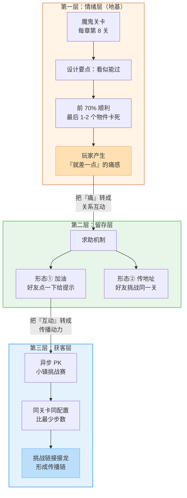
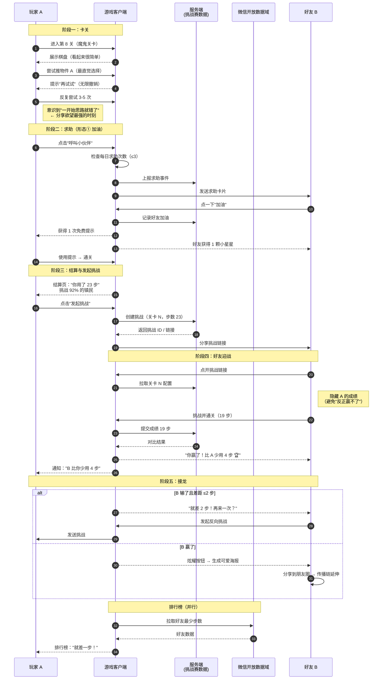
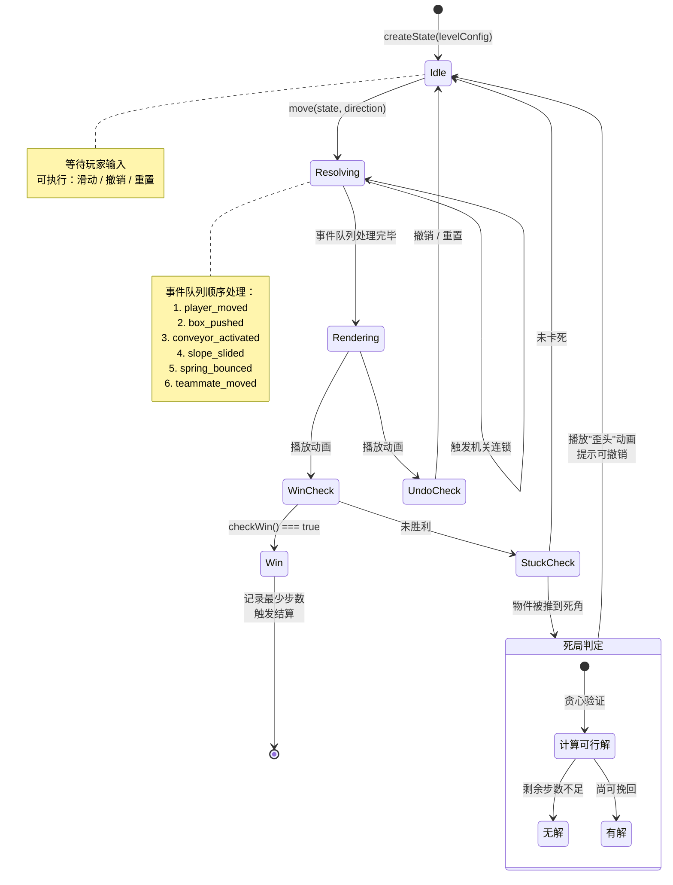
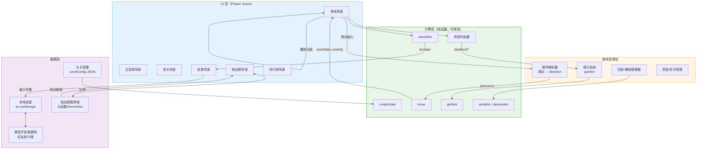

# 《云朵小镇·推推奇遇》流程图与状态图

> 本文档使用 Mermaid 语法编写，在 Gitee / GitHub / VS Code（需 Mermaid 插件）中可直接渲染。
> 对应产品文档：`docs/01-product-spec.md` v3.0

---

## 目录

1. [三层社交结构总览](#1-三层社交结构总览)
2. [玩家社交链路时序图](#2-玩家社交链路时序图)
3. [核心棋盘引擎状态机](#3-核心棋盘引擎状态机)
4. [小镇挑战赛状态流转](#4-小镇挑战赛状态流转)
5. [数据流架构图](#5-数据流架构图)
6. [求助防骚扰判定流程](#6-求助防骚扰判定流程)
7. [魔鬼关卡设计判定流程](#7-魔鬼关卡设计判定流程)

---

## 1. 三层社交结构总览

展示"魔鬼关卡 → 求助 → 异步 PK"的因果递进关系。



**核心因果链**：没有第一层制造痛点，上面两层都是空的。参考《羊了个羊》——裂变不是设计出来的，是难度逼出来的。

---

## 2. 玩家社交链路时序图

完整的"卡关 → 求助 → 加油 → 再挑战 → 发起 PK → 接龙"链路。



---

## 3. 核心棋盘引擎状态机

纯函数引擎的状态流转。**每次 `move()` 返回新的不可变状态 + 事件列表**。



---

## 4. 小镇挑战赛状态流转

```mermaid
stateDiagram-v2
    [*] --> 通关: 玩家通关第 N 关

    通关 --> 发起挑战: 点击"发起挑战"
    发起挑战 --> 生成链接: 服务端创建挑战记录
    生成链接 --> 等待好友: 分享链接 / 海报

    等待好友 --> 好友进入: 好友点开链接
    好友进入 --> 拉取配置: 拉取关卡 N 原始配置
    拉取配置 --> 复刻关卡: 棋盘/物件/机关 完全一致
    note right of 复刻关卡
        保证公平性：
        不做镜像版、不做随机配置
        隐藏对方成绩
    end note

    复刻关卡 --> 好友挑战: 好友操作
    好友挑战 --> 好友通关: 达成胜利

    好友通关 --> 提交成绩: 上报最少步数
    提交成绩 --> 结果对比: 服务端比对

    结果对比 --> 我方胜: 差值 > 2
    结果对比 --> 胶着: 差值 ≤ 2
    结果对比 --> 对方胜: 我方落后

    我方胜 --> 炫耀海报: 生成分享素材
    胶着 --> 再挑战: "就差 N 步！"
    对方胜 --> 反向挑战: 我方发起接龙

    炫耀海报 --> [*]
    再挑战 --> 发起挑战
    反向挑战 --> 发起挑战

    state 结果对比 as "结果对比（隐藏成绩）" {
        [*] --> 判定: 计算步数差
        判定 --> 不可见: 挑战中不显示
    }
```

---

## 5. 数据流架构图

分层架构：**UI 层 / 游戏逻辑层 / 引擎层 / 数据层**。



**关键约束**：引擎层（ENGINE）为纯函数，**零副作用、零渲染依赖**，可直接单元测试，也是软著源代码的主要来源。

---

## 6. 求助防骚扰判定流程

对应产品文档 6.4 的反骚扰硬约束。

```mermaid
flowchart TD
    START([玩家点击"呼叫小伙伴"]) --> CHECK_SELF{自身今日<br/>求助次数 < 3 ?}
    CHECK_SELF -->|否| REJECT1[提示：今天求助次数已用完<br/>明天再来吧 🥺]
    CHECK_SELF -->|是| SELECT[选择求助好友]

    SELECT --> CHECK_TARGET{该好友 24h 内<br/>是否已被求助过?}
    CHECK_TARGET -->|是| REJECT2[该好友今天已帮过你<br/>换一位小伙伴吧]
    CHECK_TARGET -->|否| SEND[发送求助卡片]
    REJECT2 --> SELECT

    SEND --> REWARD_SELF[玩家获得 1 次免费提示]
    SEND --> FRIEND_ACTION{好友动作}

    FRIEND_ACTION -->|点一下"加油"| REWARD_FRIEND[好友获得 1 颗小星星 ⭐]
    FRIEND_ACTION -->|忽略| EXPIRE[卡片 24h 后失效]

    REWARD_FRIEND --> COUNTER[计数 +1<br/>自身计数 / 好友计数]
    REWARD_SELF --> COUNTER
    COUNTER --> END([结束])

    REJECT1 --> END

    style REJECT1 fill:#FFCDD2,stroke:#E57373
    style REJECT2 fill:#FFCDD2,stroke:#E57373
    style REWARD_SELF fill:#C8E6C9,stroke:#66BB6A
    style REWARD_FRIEND fill:#C8E6C9,stroke:#66BB6A
```

**三条硬约束**：

| 约束 | 值 | 原因 |
|:---|:---|:---|
| 自身每日求助上限 | 3 次 | 对齐微信分享频次隐性限制 |
| 同一好友冷却 | 24 小时 | 防止对同一个人反复骚扰 |
| 求助必须"给好友东西" | 星星 | 让帮助行为有正收益，不尴尬 |

---

## 7. 魔鬼关卡设计判定流程

用于关卡设计者自检：一关是否够格被称为"魔鬼关卡"。

```mermaid
flowchart TD
    S([设计一个魔鬼关卡]) --> Q1{视觉上<br/>是否看起来可解?}
    Q1 -->|否| F1[❌ 玩家会直接放弃<br/>调整为标准规格棋盘]
    Q1 -->|是| Q2{前 70% 流程<br/>是否顺利?}

    Q2 -->|否| F2[❌ 挫败感来得太早<br/>会变成"劝退关卡"]
    Q2 -->|是| Q3{是否在最后<br/>1-2 个物件卡死?}

    Q3 -->|否| F3[❌ 没有"就差一点"的痛感<br/>社交动机不足]
    Q3 -->|是| Q4{是否存在<br/>1-2 种正确解?}

    Q4 -->|否·真无解| F4[❌ 致命：会引发<br/>《羊了个羊》式口碑危机]
    Q4 -->|是| Q5{玩家第 3-5 次<br/>尝试才会醒悟?}

    Q5 -->|第 1 次就懂| F5[❌ 太简单，没有讨论度]
    Q5 -->|是| Q6{失败提示是否<br/>不羞辱玩家?}
    Q5 -->|超过 10 次| F6[❌ 太磨人，放弃率过高]

    Q6 -->|否| F7[❌ 破坏治愈系人设<br/>改为"再想想，你一定可以"]
    Q6 -->|是| PASS[✅ 通过：可作为魔鬼关卡]

    PASS --> CHK1[公示"有解"<br/>保留解路径存档]
    CHK1 --> CHK2[配套文案：<br/>关卡名《就差一步》]
    CHK2 --> CHK3[配套海报：<br/>"据说 90% 的人在这里放弃"]
    CHK3 --> END([上线])

    F1 --> END
    F2 --> END
    F3 --> END
    F4 --> END
    F5 --> END
    F6 --> END
    F7 --> END

    style PASS fill:#C8E6C9,stroke:#66BB6A,stroke-width:2px
    style F4 fill:#FFCDD2,stroke:#E57373,stroke-width:2px
    style CHK1 fill:#FFF9C4,stroke:#FDD835
```

---

## 附：图表索引

| 编号 | 图表 | 用途 |
|:---|:---|:---|
| 1 | 三层社交结构总览 | 立项汇报、团队对齐 |
| 2 | 玩家社交链路时序图 | 开发实现依据（前后端接口） |
| 3 | 核心棋盘引擎状态机 | 引擎开发与单测依据 |
| 4 | 挑战赛状态流转 | 服务端状态机设计 |
| 5 | 数据流架构图 | 技术评审、模块划分 |
| 6 | 求助防骚扰判定流程 | 风控实现依据 |
| 7 | 魔鬼关卡设计判定流程 | 关卡设计者自检清单 |

---

*文档版本：v1.0 | 配套产品文档 v3.0 | 编写日期：2026 年 10 月*
