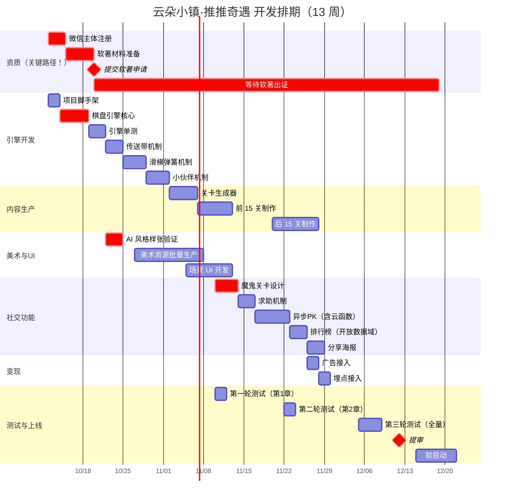

# 《云朵小镇·推推奇遇》精细执行步骤（WBS）

> 配套文档：`docs/01-product-spec.md` v3.0 · `docs/02-flowcharts.md` · `docs/03-dev-spec.md`
> 文档版本：v1.0 | 编写日期：2026 年 10 月
> 周期：13 周（含 1 周缓冲）| 模式：个人开发

---

## 目录

- [零、总览与关键路径](#零总览与关键路径)
- [一、第 0 周：资质与环境（并联启动）](#一第-0-周资质与环境并联启动)
- [二、第 1-2 周：原型验证（含软著提交）](#二第-1-2-周原型验证含软著提交)
- [三、第 3-5 周：机关系统](#三第-3-5-周机关系统)
- [四、第 5-7 周：美术与 UI](#四第-5-7-周美术与-ui)
- [五、第 7-9 周：社交功能](#五第-7-9-周社交功能)
- [六、第 9 周：变现接入](#六第-9-周变现接入)
- [七、第 9-11 周：内容扩展](#七第-9-11-周内容扩展)
- [八、第 11-12 周：测试与调优](#八第-11-12-周测试与调优)
- [九、第 12-13 周：上线](#九第-12-13-周上线)
- [十、里程碑检查清单](#十里程碑检查清单)
- [十一、风险预案](#十一风险预案)

---

## 零、总览与关键路径

### 0.1 甘特图



### 0.2 关键路径（不能延期的事）

```
微信主体注册 → 软著提交 → 软著出证 → 提审 → 上线
                          ↑
                这条路径 1-3 个月，是全局瓶颈

技术关键路径：
项目脚手架 → 棋盘引擎核心 → 引擎单测 → 机关实现 → 关卡生产 → 测试 → 提审
```

**⚠️ 最重要的排期决策**：软著必须在**第 2 周**提交，不能等代码写完。这不是"提前准备"，这是**必须并行**的事。

---

## 一、第 0 周：资质与环境（并联启动）

> **目标**：把"不能后补"的事全部启动掉。

### 1.1 资质任务

| # | 任务 | 操作 | 产出 | 工时 |
|:---|:---|:---|:---|:---|
| A1 | 微信开放平台注册 | 访问 mp.weixin.qq.com → 注册"小游戏" → 选**个人主体** → 实名认证 | 小游戏 AppID | 0.5 天 |
| A2 | 小程序/小游戏类目填写 | 选择"休闲游戏"类目 | 类目审核通过 | 0.5 天 |
| A3 | 确认 ICP 备案需求 | **在微信后台/客服确认**：纯单机 + 开放数据域排行榜是否需要备案 | 明确结论 | 0.5 天 |
| A4 | 软著材料模板准备 | 下载申请表，准备主体证明材料 | 材料就绪 | 0.5 天 |

**⚠️ A3 的说明**：不要照抄产品文档的"2-4 周"，不同场景要求不同。**明确结论出来前，不要为备案做额外投入。**

### 1.2 环境搭建

| # | 任务 | 命令/操作 |
|:---|:---|:---|
| B1 | 安装 Node（推荐 20 LTS） | 已有则跳过 |
| B2 | 安装微信开发者工具 | 官网下载稳定版 |
| B3 | 初始化项目 | `npm create vite@latest . -- --template vanilla-ts` |
| B4 | 安装依赖 | `npm i phaser` + `npm i -D vitest @types/node` |
| B5 | 配置 `tsconfig.json` | 严格模式 `strict: true` |
| B6 | 配置 `vite.config.ts` | 输出 ES5 兼容（微信小游戏要求） |
| B7 | 配置环境变量 | `.env.development` / `.env.production`，`VITE_PLATFORM=web|wx` |
| B8 | Git 初始化 | 已初始化（gitee origin） |
| B9 | 配置 `.gitignore` | `node_modules` / `dist` / `.env.local` |

**B6 关键配置示例**：

```typescript
// vite.config.ts
import { defineConfig } from 'vite';

export default defineConfig({
  build: {
    target: 'es2015',        // 微信小游戏内核对 ES2015+ 支持较好
    minify: 'terser',
    terserOptions: {
      compress: { drop_console: true },  // 生产剔除 console
    },
    rollupOptions: {
      output: {
        // 微信小游戏需要 CommonJS 风格的模块
        format: 'cjs',
      },
    },
  },
  define: {
    'import.meta.env.VITE_PLATFORM': JSON.stringify(process.env.VITE_PLATFORM || 'web'),
  },
});
```

**B9 `.gitignore` 内容**：

```
node_modules/
dist/
.env.local
.DS_Store
*.log
```

### 1.3 第 0 周出口标准

- [ ] 微信小游戏 AppID 拿到
- [ ] ICP 备案需求有明确结论（需要 / 不需要）
- [ ] 本地 `npm run dev` 能跑起空场景
- [ ] git 能正常提交

---

## 二、第 1-2 周：原型验证（含软著提交）

> **目标**：验证 4 件高风险的事 + 提交软著。

### 2.1 核心引擎开发（第 1 周）

| # | 任务 | 交付物 | 工时 |
|:---|:---|:---|:---|
| C1 | 定义全部类型（`src/engine/types.ts`） | 类型定义文件 | 0.5 天 |
| C2 | `createState()` | 状态初始化 | 0.5 天 |
| C3 | `move()` 基础版（无机关） | 移动 / 推动 / 撞墙拒绝 | 1 天 |
| C4 | `checkWin()` | 胜利判定 | 0.5 天 |
| C5 | `serialize()` / `deserialize()` | 状态序列化 | 0.5 天 |
| C6 | `undo()` | 撤销 | 0.5 天 |
| C7 | **单元测试（`tests/engine/`）** | 测试用例 ≥ 20 个 | 1.5 天 |
| C8 | `computeOptimalSteps()`（BFS 求解器） | 关卡求解 | 1 天 |

**C7 必须覆盖的场景**：

```typescript
// tests/engine/move.test.ts 必测清单
✓ 撞墙拒绝移动，状态不变（不可变性）
✓ 撞到无法推动的物件，拒绝
✓ 推动物件产生 box_pushed 事件
✓ 一步只能推一个物件（不能推两个）
✓ 物件推到目标点产生 box_on_target 事件
✓ 物件离开目标点产生 box_left_target 事件
✓ 所有物件归位判定胜利
✓ 步数正确累加
✓ 撤销恢复上一状态
✓ 连续撤销到初始状态
✓ 序列化/反序列化往返一致
✓ 边界外移动被拒绝
```

**⚠️ 到这里，代码量应已有 2500-3500 行（含注释）。这就是软著需要的量。**

### 2.2 软著提交（第 2 周初 · 关键里程碑）

| # | 任务 | 说明 |
|:---|:---|:---|
| D1 | 准备源代码文档 | **前 30 页 + 后 30 页**，每页 ≥50 行，共约 3000+ 行 |
| D2 | 准备软件说明书 | 描述功能、运行环境、操作说明（约 10-20 页） |
| D3 | 在线提交 | 中国版权保护中心官网 → 软件著作权登记 |
| D4 | 缴费 | 官费 250 元（普通） |
| D5 | 记录受理号 | 便于后续查询进度 |

**D1 操作要点**：

- 代码文档**不要包含密码、密钥、真实账号信息**
- 注释要完整（这也是你一贯的风格）
- 页眉标注软件名称 + 版本号
- 建议用 `cloc` 或脚本统计行数确认

```bash
# 统计代码行数（确认够 3000 行）
npx cloc src/engine/ --include-lang=TypeScript
```

### 2.3 Phaser 原型（第 2 周）

| # | 任务 | 交付物 | 工时 |
|:---|:---|:---|:---|
| E1 | `BootScene` + `GameScene` 骨架 | 能显示网格 | 0.5 天 |
| E2 | 程序化绘制棋盘（Graphics） | 墙/地板/目标点 | 1 天 |
| E3 | 角色与物件渲染（先占位图形） | 能显示和移动 | 0.5 天 |
| E4 | 滑动输入解析 | 手机能滑动操作 | 0.5 天 |
| E5 | 接入微信适配层 | 微信开发者工具能跑 | 1 天 |
| E6 | **真机测试滑动手感** | 真机验证记录 | 0.5 天 |

**E6 是本周最重要的验证**。真机滑动的手感必须自己试，模拟器不可信。

### 2.4 传送带机制（第 2 周末）

| # | 任务 | 工时 |
|:---|:---|:---|
| F1 | 传送带数据结构 + 渲染 | 0.5 天 |
| F2 | `resolveConveyors()` 实现 | 1 天 |
| F3 | 传送带单测（含连锁） | 0.5 天 |
| F4 | 制作 3 个传送带测试关卡 | 0.5 天 |

### 2.5 AI 美术风格验证（第 2 周 · 高风险提前验证）

| # | 任务 | 说明 |
|:---|:---|:---|
| G1 | 用 LoRA / AI 工具生成 3-5 张**同风格**样张 | 关键词：`cute chibi fox, soft pastel colors, kawaii, hand-drawn crayon style, warm lighting, storybook illustration` |
| G2 | 检查风格一致性 | **如果 5 张风格差异大 → 立即改用统一素材库方案** |
| G3 | 输出风格参考板 | 后续批量生产的基准 |

**⚠️ G2 是 Go/No-Go 决策点**。如果 AI 生成风格无法统一，不要硬扛，改用"素材库 + 换色"方案，成本上升但可控。

### 2.6 第 1-2 周出口标准

- [ ] 引擎单测全绿（≥20 个用例）
- [ ] 真机能滑动移动角色和推箱子
- [ ] 传送带机制可玩
- [ ] 3 个测试关卡可解
- [ ] **软著已提交（受理号已记录）**
- [ ] AI 美术风格验证有结论

---

## 三、第 3-5 周：机关系统

### 3.1 滑梯与弹簧（第 3 周）

| # | 任务 | 工时 |
|:---|:---|:---|
| H1 | 滑梯数据结构 + 渲染 | 0.5 天 |
| H2 | `slideBox()` 逐格滑行实现 | 1 天 |
| H3 | 弹簧数据结构 + 渲染 | 0.5 天 |
| H4 | `resolveSprings()` 弹射实现 | 1 天 |
| H5 | 机关连锁递归（深度上限 5） | 0.5 天 |
| H6 | **组合单测：传送带 × 滑梯 × 弹簧** | 1 天 |
| H7 | 制作 5 个滑梯/弹簧测试关 | 1 天 |

**H6 是本阶段的重点**：三种机制的交叉场景是 bug 重灾区。

### 3.2 小伙伴合作（第 4 周）

| # | 任务 | 工时 |
|:---|:---|:---|
| I1 | 扩展 `GameState` 支持多角色 | 0.5 天 |
| I2 | `switchActor()` 实现 | 0.5 天 |
| I3 | `move()` 支持按 `activeActorId` 移动 | 1 天 |
| I4 | 狭窄通道判定（`canSqueeze`） | 0.5 天 |
| I5 | UI：角色切换高亮 + 切换动画 | 1 天 |
| I6 | 小伙伴机制单测 | 1 天 |
| I7 | 制作 5 个小伙伴测试关 | 1 天 |

### 3.3 关卡生成器与校验器（第 5 周）

| # | 任务 | 工时 |
|:---|:---|:---|
| J1 | 字符网格 → `LevelConfig` 编译器 | 1 天 |
| J2 | 反向构造生成器（**仅纯推箱子**） | 2 天 |
| J3 | 关卡校验器（`tools/validator.ts`） | 1 天 |
| J4 | 最优步数批量计算 | 0.5 天 |
| J5 | 命令行工具封装 | 0.5 天 |

**J3 校验器检查项**（对应 `docs/03-dev-spec.md` 4.3）：

```typescript
// tools/validator.ts 伪代码
export function validateLevel(config: LevelConfig): ValidationReport {
  return {
    hasSolution: computeOptimalSteps(config) !== Infinity,     // 必须有解
    stepsInRange: checkStepRange(config),                       // 步数在区间内
    noBoxOnTarget: checkInitialQuality(config),                 // 初始状态质量
    noUnreachableTargets: checkReachability(config),            // 目标可达
    wallsEnclose: checkEnclosure(config),                       // 地图封闭
  };
}
```

### 3.4 第 3-5 周出口标准

- [ ] 3 个机制全部可用且单测覆盖
- [ ] 机关组合单测通过（含连锁递归）
- [ ] 关卡生成器可产出纯推箱子关卡
- [ ] 关卡校验器可自动过滤无解关卡
- [ ] 已有 15 关可玩

---

## 四、第 5-7 周：美术与 UI

### 4.1 美术资源生产（第 5-6 周，与关卡生产并行）

| # | 任务 | 说明 | 工时 |
|:---|:---|:---|:---|
| K1 | 3 个章节背景图 | AI 生成 + 柔化处理 + WebP 压缩 | 2 天 |
| K2 | 主角小狐狸精灵图 | 待机/移动/推送/歪头 4 组动画 | 2 天 |
| K3 | 小猫皮肤（可选） | 复用狐狸骨架 | 1 天 |
| K4 | 物件贴图 | 南瓜/毛线球/礼物盒/蛋糕 | 1 天 |
| K5 | 机关贴图 | 传送带/滑梯/弹簧（程序化 + 贴图混合） | 1.5 天 |
| K6 | 小伙伴精灵 | 兔子/松鼠 | 1.5 天 |
| K7 | UI 素材 | 按钮/面板/图标（**用 iconfont**） | 1 天 |
| K8 | **包体检查** | 每加一批资源就测一次包体 | 每批 10 分钟 |

**K8 必须做**。产品文档要求首包 ≤3.5MB，资源超限是常见问题。

### 4.2 音效（第 6 周）

| # | 任务 | 说明 |
|:---|:---|:---|
| L1 | 从 freesound.org 收集音效 | **必须确认商用授权 + 是否需署名** |
| L2 | 操作/推动/传送/滑行/弹射/胜利 6 类 | 每类 1-2 个 |
| L3 | 变调处理复用 | 减少文件数 |
| L4 | 压缩（低比特率 mp3） | 体积控制 |

**⚠️ L1 的授权确认不能跳过**。部分 CC 素材要求署名，商用会有法律风险。

### 4.3 UI 场景开发（第 6-7 周）

| # | 任务 | 工时 |
|:---|:---|:---|
| M1 | `MenuScene`（主菜单） | 1 天 |
| M2 | `LevelSelectScene`（选关地图） | 2 天 |
| M3 | `ResultScene`（结算页） | 1.5 天 |
| M4 | 游戏内 HUD（步数/撤销/提示按钮） | 1 天 |
| M5 | 设置弹窗（音效/音乐开关） | 0.5 天 |
| M6 | 通用组件（弹窗/按钮/加载） | 1 天 |

### 4.4 第 5-7 周出口标准

- [ ] 三个章节背景 + 全部核心美术资源就绪
- [ ] 首包 ≤3.5MB
- [ ] 主菜单/选关/结算/游戏内 HUD 全部可用
- [ ] 音效授权确认完毕

---

## 五、第 7-9 周：社交功能

> **这是本项目的核心差异化，也是优先级最高的开发阶段。**

### 5.1 魔鬼关卡（第 7 周 · P0）

| # | 任务 | 工时 |
|:---|:---|:---|
| N1 | 按自检流程设计魔鬼关卡（每章 1 个，共 3 个） | 1 天 |
| N2 | 接入"再试试"友好提示（非羞辱文案） | 0.5 天 |
| N3 | 结算页"比 X% 的镇民聪明" | 0.5 天 |
| N4 | **人工验证"看似能过"** | 0.5 天 |
| N5 | 存档解路径（应对"无解"投诉） | 0.5 天 |

**N4 必须找真人测**，自己测不算数（你知道答案）。

### 5.2 求助机制（第 7-8 周 · P0）

| # | 任务 | 工时 |
|:---|:---|:---|
| O1 | 云函数 `sendHelp`（含防骚扰计数） | 1 天 |
| O2 | 求助弹窗 UI | 0.5 天 |
| O3 | 微信分享卡片（形态①和②） | 1 天 |
| O4 | "加油"接收页 + 奖励发放 | 1 天 |
| O5 | 每日 3 次 + 好友 24h 冷却校验 | 0.5 天 |

### 5.3 异步 PK（第 8 周 · P1）

| # | 任务 | 工时 |
|:---|:---|:---|
| P1 | 云数据库表设计 + 初始化 | 0.5 天 |
| P2 | 云函数 `createChallenge` | 1 天 |
| P3 | 云函数 `joinChallenge`（**不返回对方步数**） | 1 天 |
| P4 | 云函数 `submitResult`（含防作弊校验） | 1 天 |
| P5 | `ChallengeScene` 挑战结果页 | 1 天 |
| P6 | "就差 N 步"再挑战逻辑（差 ≤2 触发） | 0.5 天 |
| P7 | 挑战链接分享 + 落地页 | 1 天 |

**P3 的关键约束**：`joinChallenge` **绝对不能返回 `creatorSteps`**，这是公平性设计的核心。

### 5.4 排行榜（第 8-9 周 · P1）

| # | 任务 | 工时 |
|:---|:---|:---|
| Q1 | 开放数据域子包初始化 | 0.5 天 |
| Q2 | `wx.setUserCloudStorage` 上报最少步数 | 0.5 天 |
| Q3 | 子域渲染好友最少步数榜 | 1.5 天 |
| Q4 | 章节进度榜 | 0.5 天 |
| Q5 | "差一点"高亮提示 | 0.5 天 |

### 5.5 分享海报（第 9 周 · P2）

| # | 任务 | 工时 |
|:---|:---|:---|
| R1 | 海报模板设计（Canvas 绘制） | 1 天 |
| R2 | 生成 + 保存到相册 | 1 天 |
| R3 | 炫耀按钮触发逻辑 | 0.5 天 |

### 5.6 第 7-9 周出口标准

- [ ] 3 个魔鬼关卡上线，人工验证通过
- [ ] 求助-加油闭环可用，防骚扰生效
- [ ] 挑战赛可发起 / 可加入 / 可对比
- [ ] 好友排行榜可显示
- [ ] 分享海报可生成

---

## 六、第 9 周：变现接入

| # | 任务 | 说明 | 工时 |
|:---|:---|:---|:---|
| S1 | 申请广告位 | 微信后台开通激励视频广告位 | 0.5 天 |
| S2 | `AdAdapter` 实现 | `onLoad` / `onError` / `onClose` | 1 天 |
| S3 | **`isEnded` 校验** | 跳过不发奖励 | 0.5 天 |
| S4 | 降级逻辑 | 广告失败 → 分享求助 | 0.5 天 |
| S5 | 5 个触发点接入 | 复活/提示/隐藏关/每日/翻倍 | 1 天 |
| S6 | 频次限制 | 每关/每日上限 | 0.5 天 |
| S7 | **埋点接入** | 留存/关卡流失/广告观看率 | 1 天 |

**S7 埋点必须在提审前完成**，否则上线后无法迭代。建议埋点清单：

| 事件 | 参数 |
|:---|:---|
| `app_launch` | 来源场景值 |
| `level_start` | levelId |
| `level_complete` | levelId, steps, duration, retryCount |
| `level_quit` | levelId, steps（**流失点分析**） |
| `hint_use` | levelId, isFree |
| `ad_show` | placement, result |
| `ad_complete` | placement（**对比 ad_show 算完播率**） |
| `help_send` | levelId |
| `help_received` | levelId |
| `challenge_create` | levelId, steps |
| `challenge_join` | levelId, steps, iWin |
| `share` | scene, channel |

---

## 七、第 9-11 周：内容扩展

### 7.1 关卡生产（30 关）

| 章节 | 关卡 | 生产方式 | 工时 |
|:---|:---|:---|:---|
| 第一章（1-10） | 教学 3 + 组合 4 + **魔鬼 1** + 挑战 2 | 60% 生成 + 40% 手调 | 3 天 |
| 第二章（11-20） | 同上 | 同上 | 3 天 |
| 第三章（21-30） | 同上 | 同上 | 4 天 |

### 7.2 难度调优

| # | 任务 | 工时 |
|:---|:---|:---|
| T1 | 用校验器批量检查全 30 关 | 0.5 天 |
| T2 | 按"最优步数"排序，检查曲线平滑度 | 0.5 天 |
| T3 | **难度曲线可视化**（步数 vs 关卡号折线图） | 0.5 天 |
| T4 | 调整异常关卡（台阶式跳难） | 1 天 |

**T3 建议做成图表**，能直观发现"某关突然变难"的问题。

---

## 八、第 11-12 周：测试与调优

### 8.1 三轮测试安排

```mermaid
graph LR
    A[第一轮<br/>第1章完成时] --> B[第二轮<br/>第2章完成时]
    B --> C[第三轮<br/>全量30关]
    C --> D[上线]

    A -.关注.-> A1[上手是否 3 秒懂<br/>教学关是否有效]
    B -.关注.-> B1[机关组合是否可理解<br/>魔鬼关是否"卡而不劝退"]
    C -.关注.-> C1[难度曲线<br/>流失点<br/>社交动机]

    style A fill:#E3F2FD
    style B fill:#FFF4E6
    style C fill:#C8E6C9
```

| 轮次 | 时间 | 测试人数 | 关注重点 | 产出 |
|:---|:---|:---|:---|:---|
| 第一轮 | 第 7 周 | 3-5 人 | 上手门槛、教学效果 | 教学关调整 |
| 第二轮 | 第 9 周 | 5-8 人 | 机关理解、魔鬼关卡 | 难度调整 |
| 第三轮 | 第 11-12 周 | 10-20 人 | 全量、留存、社交 | 最终调优 |

### 8.2 测试必问的问题

1. **你第一次玩，知不知道要干什么？**（上手门槛 A）
2. **哪个关卡让你想放弃？为什么？**（流失点）
3. **你玩过之后，想不想发给朋友？发的话你会说什么？**（社交动机 D）
4. **魔鬼关卡你试了几次？有没有觉得"这关是不是无解"？**（⚠️ 关键，口碑风险）
5. **如果卡住了，你愿意看广告还是求朋友？**（变现偏好）

### 8.3 兼容性测试

| 项 | 覆盖 |
|:---|:---|
| 机型 | 低端安卓（千元机）+ 中端 + iPhone |
| 分辨率 | 全面屏 / 刘海屏 / 平板 |
| 系统 | Android 8+ / iOS 13+ |
| 网络 | 弱网（3G）/ 断网（挑战赛降级） |
| 音频 | 静音模式下的完整体验（**验证是否有纯音频依赖**） |

---

## 九、第 12-13 周：上线

### 9.1 提审前检查清单

- [ ] **软著证书已到手**（⚠️ 硬性前置，没到手不能提审）
- [ ] 隐私协议页面（微信要求）
- [ ] 适龄提示（微信要求）
- [ ] 广告位已开通且测试正常
- [ ] 埋点数据能正常上报
- [ ] 包体 ≤3.5MB
- [ ] 首屏加载 ≤3 秒
- [ ] 无 `console.log` 泄漏（构建已剔除）
- [ ] 无真实密钥 / 账号信息
- [ ] 分享卡片文案与图片已配置

### 9.2 提审 → 上线 → 软启动

| # | 任务 | 说明 |
|:---|:---|:---|
| U1 | 提交审核 | 微信后台提交，注意类目与资质 |
| U2 | 审核反馈处理 | 通常 1-3 个工作日出结果 |
| U3 | 发布上线 | 审核通过后发布 |
| U4 | **种子用户启动** | 朋友圈 / 微信群分享 |
| U5 | 数据监控 | 次日留存 / 关卡流失 / ARPU |
| U6 | 素材测试 | 日均 50-100 条（**需真实预算**） |

### 9.3 上线后迭代节奏

| 周期 | 动作 |
|:---|:---|
| 每 2 周 | 追加 10 关 |
| 每周 | 看埋点数据，找流失点 |
| 每 4 周 | 评估是否加入 v1.1 的"音乐花丛/镜子小屋" |

---

## 十、里程碑检查清单

| 里程碑 | 时间 | 出口标准 | 阻塞风险 |
|:---|:---|:---|:---|
| **M0 环境就绪** | 第 0 周末 | AppID + 脚手架跑通 | 无 |
| **M1 引擎可用** | 第 2 周末 | 单测全绿 + 软著已提交 | 软著材料不足 3000 行 |
| **M2 机制完整** | 第 5 周末 | 3 机制 + 生成器 | 机关组合 bug |
| **M3 内容可玩** | 第 7 周末 | 15 关 + 美术就绪 | 美术风格不统一 |
| **M4 社交闭环** | 第 9 周末 | 三层社交可用 | 云函数调试 |
| **M5 功能完整** | 第 11 周末 | 30 关 + 变现 + 埋点 | 时间不足 |
| **M6 上线** | 第 13 周 | 审核通过 + 发布 | **软著未出证（最大阻塞）** |

---

## 十一、风险预案

| 风险 | 触发信号 | 预案 |
|:---|:---|:---|
| **软著未按时出证** | 第 11 周仍未出证 | ① 加急（额外费用）② 先上微信"体验版"给种子用户玩，收集数据 ③ 等证书再正式发布 |
| **AI 美术风格不统一** | 第 2 周 G2 验证不通过 | 改用"统一素材库 + 换色 + 程序化绘制"方案 |
| **机关组合 bug 过多** | 第 5 周组合单测失败率高 | **砍掉小伙伴机制**（保留传送带 + 滑梯弹簧），降为 v1.1 |
| **关卡生产超时** | 第 10 周关卡数不足 30 | **首发 20 关上线**，后续追加 |
| **包体超限** | 第 7 周包体 >4MB | ① 背景图降质 ② 音效降比特率 ③ 按章节分包 |
| **魔鬼关卡被投诉无解** | 测试反馈"靠运气" | 立即公示解路径 + 调整为"有明确接近感" |
| **云函数调试卡住** | 第 8 周 PK 功能无进展 | **降级为"纯本地对比"**（用开屏数据域做弱版 PK） |
| **微信审核不通过** | 提审被拒 | 按反馈修改；常见原因：资质、类目、隐私协议 |

---

## 附：每日/每周节奏建议

**每日**：

- 上午：写代码（引擎/功能）
- 下午：做内容（关卡/美术）
- 收工前：`git commit`，跑一遍单测

**每周**：

- 周一：确认本周 WBS 任务
- 周五：检查出口标准，记录卡点
- 周末：看一眼包体大小和进度

**提交规范建议**：

```
feat(engine): 实现传送带连锁机制
fix(engine): 修复滑梯与传送带同时触发时的顺序错误
feat(ui): 新增结算页"比 X% 镇民聪明"文案
chore(assets): 压缩第一章背景图至 180KB
docs: 更新产品文档 v3.0
```

---

*文档版本：v1.0 | 编写日期：2026 年 10 月*
